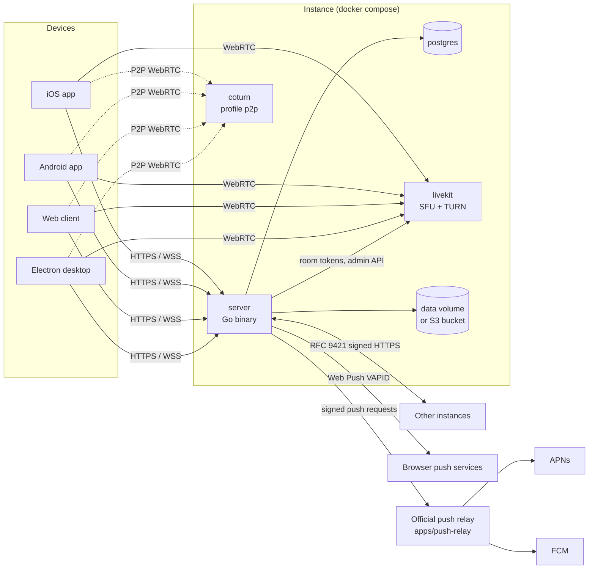
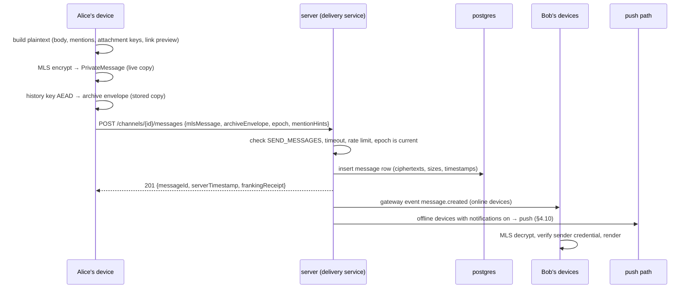
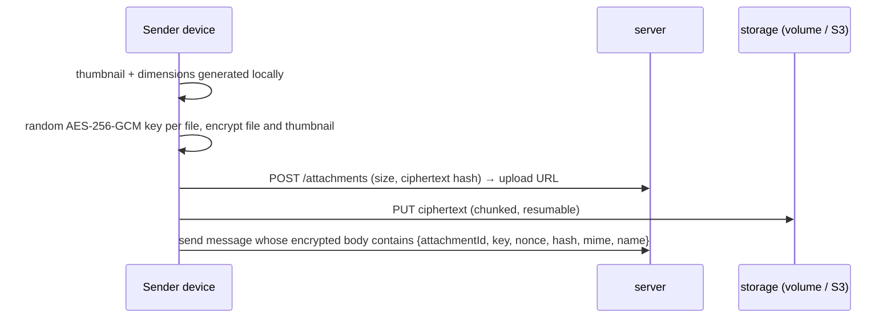
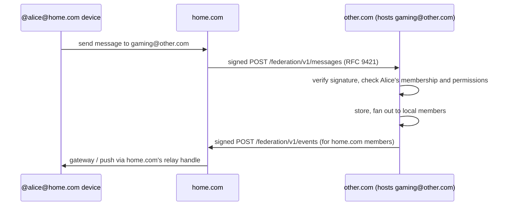
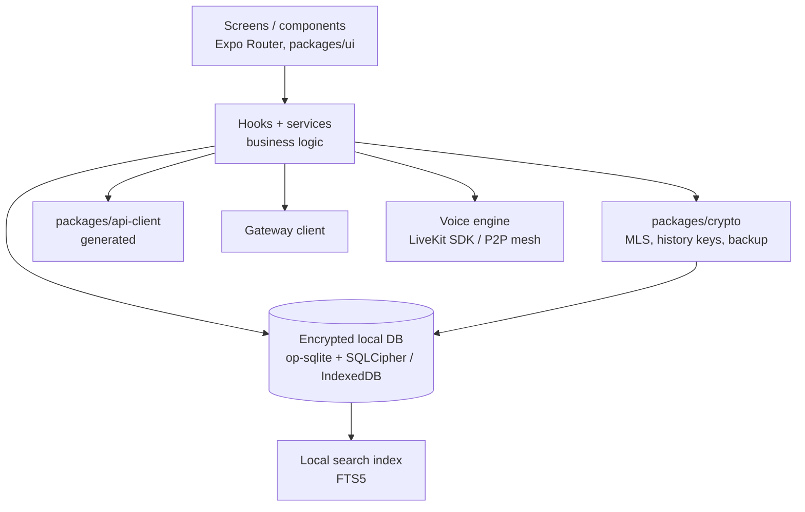
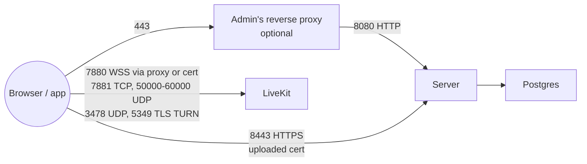

# Nexus Chat — Architecture

Status: Phase 0 design. Nothing here is implemented yet. Decisions marked
**[REVIEW]** are waiting for maintainer sign-off (see the end of
[`roadmap.md`](roadmap.md)).

## 1. Goals that shape the architecture

1. **The server never has plaintext user content.** Every component that
   handles messages, attachments, reactions, link previews, or call media
   handles ciphertext only. See [`threat-model.md`](threat-model.md).
2. **One `.env` file and `docker compose up -d`.** Three containers by
   default: `server`, `postgres`, `livekit`.
3. **A single Go binary does the server-side work.** It serves the API,
   WebSocket, federation, the MLS delivery service, the web client, and
   optional TLS.
4. **One client codebase.** Expo (React Native) for iOS, Android and web;
   Electron wraps the web build for desktop.
5. **Single node for beta, without blocking scale-out later.** In-memory
   state lives behind small interfaces that a Redis-backed implementation can
   replace.

## 2. Components



| Component | Location | Responsibility |
|---|---|---|
| `server` | `apps/server` | REST API (OpenAPI spec-first), WebSocket gateway, MLS delivery service and key-package directory, federation, file storage, web client hosting, TLS, setup wizard, admin panel API |
| `push-relay` | `apps/push-relay` | Accepts signed, opaque push payloads from registered instances and forwards them to APNs/FCM. Run by the project publisher; [`push-notifications.md`](push-notifications.md) |
| `client` | `apps/client` | Expo app for iOS, Android, web. All MLS, attachment and search work happens here |
| `desktop` | `apps/desktop` | Electron shell: screen/window picker, system audio, tray, global push-to-talk, `safeStorage` |
| `crypto` | `packages/crypto` | TS wrapper around the MLS library, key backup, attachment encryption, history keys. The only package that touches key material |
| `api-client` | `packages/api-client` | TS client generated from `apps/server/api/openapi.yaml` |
| `ui` | `packages/ui` | Accessible components, theme tokens, `motion.ts` |
| PostgreSQL | container | Accounts, structure, permissions, ciphertext, key packages, audit log |
| LiveKit | container | SFU for voice/video/screen share, built-in TURN |
| coturn | container (profile `p2p`) | TURN for P2P call mode only |

## 3. Server internals

The Go server is organized **by feature**, with `handler → service → store`
layering inside each feature (code standards §8.2).

```
apps/server/
├── api/openapi.yaml            # the contract
├── cmd/nexus-chat-server/main.go  # explicit wiring of every dependency
└── internal/
    ├── accounts/   auth/   sessions/   social/
    ├── servers/    channels/   permissions/   invites/   roles/
    ├── messages/   attachments/   reactions/   threads/   readstate/
    ├── mls/        # delivery service + key package directory
    ├── realtime/   # WebSocket gateway, presence, typing
    ├── federation/ # discovery, signing, outbound queue, inbound handlers
    ├── push/       # relay client, Web Push, UnifiedPush
    ├── voice/      # LiveKit tokens, P2P signaling, mode selection
    ├── moderation/ audit/   reports/
    ├── admin/      setup/   tlsconfig/   instanceconfig/
    └── platform/   # db pool, clock, id generation, rate limiting, logging
```

- **HTTP routing** uses `net/http.ServeMux` patterns (Go 1.22+). The
  `oapi-codegen` strict-server interface for `net/http` is generated from the
  OpenAPI file; handlers implement it.
- **Database access** goes only through `sqlc`-generated code in each
  feature's `store` package, over a shared `pgx` pool. `goose` migrations are
  embedded with `embed.FS` and run before the HTTP listener starts.
- **In-memory state** (presence, typing, WebSocket connection registry,
  rate-limit buckets) sits behind interfaces such as `PresenceTracker` and
  `EventBus`. The beta implementations are in-process. A multi-node
  deployment would add Redis-backed implementations without changing callers.

### 3.1 Real-time gateway

One WebSocket per device at `/api/v1/gateway`. Frames are JSON objects
`{ "type": "...", "id": "...", "data": {...} }`, documented in
`docs/realtime-protocol.md` (written in milestone M2). Server → client events
carry a per-device monotonically increasing sequence number so a reconnecting
device can resume with `resume { lastSequence }` and receive what it missed
from the durable queue (MLS messages) or a resync hint (non-durable events).

## 4. Data flows

### 4.1 Sending a channel message



`mentionHints` lists the user IDs mentioned in the message. It is metadata the
sender chooses to reveal so the server can send mention-only notifications and
badge counts. It is listed in the threat model. A client can omit it (the
server then treats the message as "all messages" priority for everyone).

### 4.2 Attachments



The server knows only the ciphertext size, upload time, and which message
references it.

### 4.3 Federated server (home-hosted)



Details: [`federation-protocol.md`](federation-protocol.md).

## 5. Client architecture



- **Native:** `op-sqlite` built with SQLCipher and FTS5. The database key is
  held in the iOS Keychain / Android Keystore (`expo-secure-store`).
- **Web:** IndexedDB records encrypted with AES-GCM under a non-extractable
  WebCrypto key, which is itself stored in IndexedDB (`CryptoKey` objects are
  structured-cloneable without exposing key bytes). Search uses SQLite WASM
  with FTS5 over the Origin Private File System. Page-level encryption comes
  from the WASM build of SQLite3 Multiple Ciphers (MIT). Its database key is a
  random key stored only in wrapped form (AES-KW under the non-extractable
  wrapping key) and unwrapped into memory while the app runs. A non-extractable
  key cannot hand its own bytes to SQLite, which is why the wrapping step is
  needed. The WASM build's maturity on Safari is verified
  in the search milestone before it is relied on; the fallback is an in-memory
  index rebuilt per session.
- **Electron:** same as web, with the wrapping key protected by
  `safeStorage`.

## 6. Deployment topology



Ports, firewall rules and reverse-proxy examples are covered in
`docs/self-hosting.md` (milestone M1).

## 7. Cross-cutting concerns

| Concern | Approach |
|---|---|
| IDs | UUIDv7 (time-ordered) generated by the server; clients generate a separate idempotency key per send |
| Time | All timestamps are server-assigned UTC; an injected `Clock` interface makes tests deterministic |
| Rate limiting | Token buckets keyed by IP (real client IP via `TRUSTED_PROXIES`), account, and device |
| Logging | `log/slog` JSON. Never logs ciphertext, tokens, or request bodies |
| Config | `.env` for the few boot values; everything else in the `instance_settings` table, edited in the Admin panel |
| Secrets generated on first boot | JWT signing key, LiveKit API key/secret, TURN secret, VAPID keys, instance federation key, push-relay instance key; written to `DATA_DIR/secrets/` with `0600` permissions |
| i18n | All strings go through `i18next` resource files from day one (English only) |

## 8. Related ADRs

See [`adr/`](adr/) for the reasoning behind every major choice.
