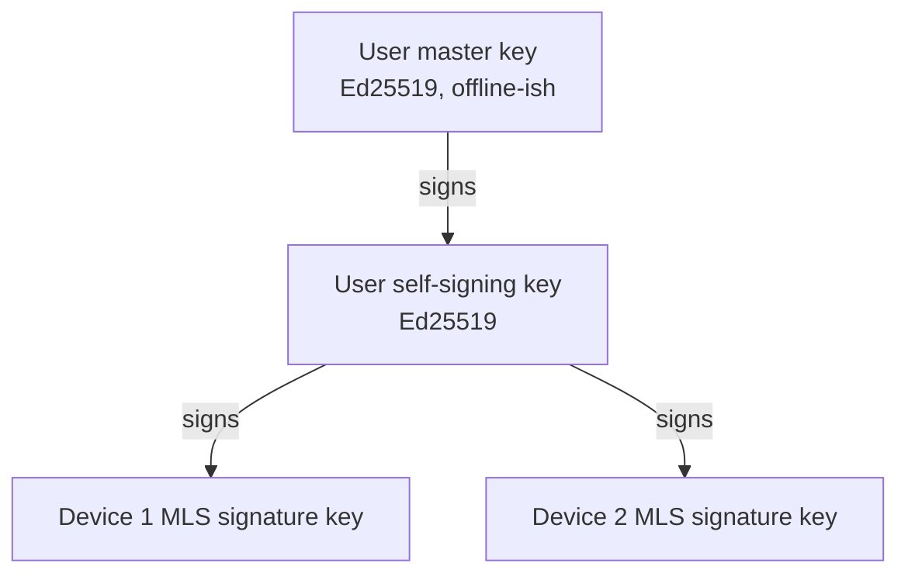

# Nexus Chat — End-to-End Encryption Design

Status: Phase 0 design. Items marked **[REVIEW]** need maintainer approval.
Related: [`threat-model.md`](threat-model.md), ADRs
[0002](adr/0002-mls-library.md), [0003](adr/0003-history-sharing.md),
[0010](adr/0010-abuse-reports.md).

Rule from the spec: no custom primitives or protocols. Everything below is MLS
(RFC 9420), the MLS exporter, and standard AEAD and signature primitives from
WebCrypto or libsodium, combined in ways the MLS RFC explicitly leaves to the
application (credential validation, exporter use, commit authorization). Where a
step goes beyond what MLS defines, this document says so and explains why.

## 1. Building blocks

| Purpose                                             | Primitive                                                                      | Source                                                             |
| --------------------------------------------------- | ------------------------------------------------------------------------------ | ------------------------------------------------------------------ |
| Group key agreement, membership, message encryption | MLS, ciphersuite `MLS_128_DHKEMX25519_AES128GCM_SHA256_Ed25519` (0x0001)       | MLS library ([ADR 0002](adr/0002-mls-library.md))                  |
| User identity / cross-signing                       | Ed25519                                                                        | libsodium (`react-native-libsodium`, `libsodium-wrappers-sumo`)    |
| History archive and attachments                     | AES-256-GCM                                                                    | WebCrypto (`crypto.subtle`; `react-native-quick-crypto` on native) |
| Attachments over 64 MiB                             | XChaCha20-Poly1305 secretstream (`crypto_secretstream_xchacha20poly1305`)      | libsodium                                                          |
| Key backup encryption                               | XChaCha20-Poly1305 (`crypto_secretbox` / `crypto_aead_xchacha20poly1305_ietf`) | libsodium                                                          |
| Password-derived backup key                         | Argon2id (`crypto_pwhash`)                                                     | libsodium                                                          |
| Media frames                                        | LiveKit frame encryption (SFU), WebRTC encoded transforms (P2P)                | LiveKit SDKs / browser                                             |

Ciphersuite 0x0001 is the mandatory-to-implement suite (RFC 9420 §17.1), so
every compliant library supports it. A post-quantum hybrid suite (X-Wing) can
be adopted later through a coordinated upgrade (§11).

## 2. Identities and devices



- **User master key (UMK).** Created at signup. Its public half is published
  on the user's home instance and fingerprinted on the profile ("safety
  number"). The private half lives only in the encrypted key backup (§5) and is
  loaded on a device only when that device needs to sign a new self-signing
  key.
- **Self-signing key (USK).** Signed by the UMK. Present on every verified
  device; used to certify device keys.
- **Device key.** Each device is its own MLS client. Its MLS leaf uses a
  `BasicCredential` whose identity is `@user@instance/deviceId`, with a
  leaf-node extension carrying the USK's signature over the device's MLS
  signature public key.
- **Credential validation (RFC 9420 §5.3.1 leaves this to the application).**
  A client accepts a leaf only if its device certificate chains to the
  user's UMK, and that UMK matches the key the user's home instance publishes
  (trust on first use, plus explicit verification below). A changed UMK shows
  a warning in every conversation with that user.
- **Linking a new device.** The new device shows a QR code (or a six-group
  comparison code) containing a fresh X25519 public key and a nonce. An
  existing device scans it, the two derive a shared key over a
  libsodium `crypto_kx` exchange relayed by the server, the user confirms the
  comparison code on both screens, and the existing device sends the USK and
  the backup key over that channel, then signs the new device certificate.
- **Signed statements.** Each signature covers a label naming what is
  signed (`nexus-chat self-signing key v1`, `nexus-chat device key v1`)
  followed by each field with a 4-byte length, so a signature over one
  kind of statement can never be read as another. The safety number is
  12 groups of 5 digits from SHA-512 over the labelled master public key
  (`packages/crypto/src/identity/identity.ts`).
- **User-to-user verification.** Optional, by QR or comparing the UMK safety
  number in person; marks the contact verified.

## 3. MLS groups

### 3.1 What maps to a group

| Conversation   | MLS group                                                                               |
| -------------- | --------------------------------------------------------------------------------------- |
| DM             | One group containing all devices of both users                                          |
| Group DM       | One group containing all devices of all members                                         |
| Server channel | One group per **audience**: the set of members who hold `VIEW_CHANNEL` on it (approved) |

A large server with 40 channels, 35 of them visible to `@everyone`, gets one
group for those 35 plus one per distinct restricted audience, instead of 40
groups. Channel-specific keys are derived inside the group with the MLS
exporter, using a label that includes the channel ID (§4). When a permission
change alters a channel's audience, the channel moves to the group matching its
new audience (creating one if needed). Old history keys stay with the old
group's members, which matches the permission semantics: losing
`VIEW_CHANNEL` takes effect for future messages. The server cannot read or
change messages, so it cannot "remove" history a member already decrypted; the
UI states this.

### 3.2 Who changes membership

The server knows membership and permissions but cannot commit (it has no
leaf). MLS handles this with standard mechanisms:

- **Joining.** A joining device performs an **external commit**
  (RFC 9420 §12.4.3.2) using the `GroupInfo` the delivery service holds. The
  server accepts the commit only if the user is entitled to be in that
  audience. Committers must upload a fresh signed `GroupInfo` with every
  commit, and the server rejects commits that lack one. This lets users join
  without waiting for an existing member to come online. The server attaches
  a signed admission directive (`{groupId, user, issuedAt}`, same format as
  the removal directives below), and members reject an external join that
  lacks one.
- **Adding devices of an existing member.** Same: the new device
  external-commits after it is linked (§2).
- **Removing** (leave, kick, ban, permission loss, device revoked, account
  deleted). The server publishes a **membership directive**: a small record
  `{groupId, removeLeaves[], reason, issuedAt}` signed with the instance's
  Ed25519 key (Go standard library `crypto/ed25519`). The next member device
  that sends anything must first commit the matching `Remove` proposals.
  Clients also commit pending removals in the background as soon as any member
  device is online. Until the commit lands, the server stops delivering
  anything to the removed devices and refuses their sends, so they gain
  nothing from the delay.
- **Authorization of commits (application policy, RFC 9420 §12.1.8 and
  §13.4 leave this to the application).** Clients reject a commit that
  removes another user's leaf unless a valid directive backs it, so one
  member cannot silently remove others. Self-removal and removing one's own
  devices need no directive.
- _Alternative considered:_ making the server an MLS **external sender**
  (RFC 9420 §12.1.8.1). It is the protocol-native option, but the server
  would then have to build and sign MLS `PublicMessage` proposals and so run
  an MLS implementation in Go, which no mature Go library supports today.
  Directives give the same outcome with the server signing plain records.
- **Commit ordering.** The delivery service accepts exactly one commit per
  epoch per group (first valid wins) and rejects others with
  `409 epoch_conflict`; losing clients re-sync and retry. This is the
  standard DS role from RFC 9420 §14 and the MLS architecture document.
- **Key packages.** Each device keeps at least 50 one-time key packages plus
  one last-resort key package on its home instance, and tops them up when the
  server reports fewer than 20. Remote instances fetch key packages through
  federation from the user's home instance.

### 3.3 Large groups

MLS commits and updates cost O(log n), but external joins and removals are
still a commit fanned out to every member, and a `Welcome`/`GroupInfo`
carrying the ratchet tree grows linearly with group size. We have not found
benchmark data for the chosen library on mobile hardware with thousands of
members, so the load-testing milestone measures commit, join and decrypt cost
at 100, 1,000 and 5,000 devices on a mid-range Android phone. The documented
server member cap is set from those results rather than guessed.

## 4. Message encryption: live copy and archive copy

MLS provides forward secrecy and post-compromise security for live delivery,
but by design a device that joins later cannot decrypt earlier
`PrivateMessage`s. Search, new devices, and `READ_HISTORY_BEFORE_JOIN` all
need history. Every message is therefore sent in two forms:

1. **Live copy:** an MLS `PrivateMessage`. Delivered to current member
   devices and kept by the server only until every member device has fetched
   it or 30 days have passed (whichever is first).
2. **Archive copy:** the same plaintext encrypted with AES-256-GCM under the
   channel's current **history key**, plus the sender's MLS signature over
   the plaintext, channel ID, epoch and message ID (so the archive copy is as
   authenticated as the live copy). Kept for the channel's retention period.

```
historyKey(channel, epoch) =
  MLS-Exporter("nexus-chat history v1", channelId || epoch, 32)
```

The history key changes with every epoch, so it changes whenever membership
changes. A member who is removed holds history keys only for epochs they were
present in, never later ones.

Edits, deletions-by-author, reactions, and thread replies are ordinary
messages whose plaintext references the target message ID, so they get the
same treatment.

### 4.1 Where history keys live

- Devices store history keys in their encrypted local database.
- Each user's history keys are also added to their **key backup** (§5), so a
  new device of the same user can read everything the user could read.
- History keys for channels with `READ_HISTORY_BEFORE_JOIN` are shared with
  new members (§6).

## 5. Key backup and recovery

The backup is a set of encrypted blobs on the user's home instance:

```
backupKey: 256-bit random key, created at signup
backup blob = XChaCha20-Poly1305(backupKey, {UMK, USK, history keys, index-sync keys})
```

History keys are appended as separate blobs (one per group and month) so the
backup grows incrementally and a new device can fetch only what it needs.

The backup key is stored on the server wrapped under each enabled unlock
method:

| Method          | Wrapping key                                                                                                                                                                                                                                                                                    |
| --------------- | ----------------------------------------------------------------------------------------------------------------------------------------------------------------------------------------------------------------------------------------------------------------------------------------------- |
| Recovery phrase | 24-word BIP-39-style phrase (256 bits of entropy, above the spec's 128-bit minimum) → HKDF-SHA256 with a per-user salt → wrapping key. A slow hash adds nothing at 256 bits of entropy. The phrase is shown at signup and the app reminds the user until they confirm it                        |
| Password        | Argon2id(password, salt_backup, "nexus-chat backup v1") with parameters `opslimit=3, memlimit=256 MiB` (lowered to 64 MiB on devices that cannot allocate more, with the parameters stored alongside the blob). The salt and context are separate from login (login never uses this derivation) |
| Passkey         | WebAuthn PRF extension output → HKDF → wrapping key. Offered only where the authenticator and platform report PRF support                                                                                                                                                                       |
| Existing device | Device-to-device transfer during linking (§2); no server-side wrapped copy needed                                                                                                                                                                                                               |

- **Changing the password** re-wraps the backup key client-side. A **password
  reset by email** cannot do this (the client does not know the old
  password), so after an email reset the password unlock method is disabled
  until the user restores keys with another method or starts fresh.
- **Starting fresh:** with no recovery phrase and no existing device, the
  user generates a new UMK. Contacts see the identity-change warning. Old
  history stays unreadable. The signup and reset screens state this in plain
  language before the user proceeds.
- **OAuth-only and passkey-only accounts** use recovery phrase, passkey PRF,
  and existing device.

## 6. History for new members — `READ_HISTORY_BEFORE_JOIN` **[REVIEW]**

Full analysis in [ADR 0003](adr/0003-history-sharing.md). Summary of the
recommended design:

1. When a device commits a join or sees a new member join a channel whose
   audience has `READ_HISTORY_BEFORE_JOIN`, the first online member device with
   history keys for that channel creates a **history bundle**: the list of
   `(epoch, historyKey)` pairs for the channel.
2. The bundle is sent as an MLS application message in the new epoch,
   addressed by channel ID, so only current members (including the new one)
   can decrypt it.
3. The new member's device fetches archive copies and decrypts them with the
   bundle's keys, lazily, as the user scrolls or search backfills.

**Tradeoff:** history keys are long-lived by design, so a compromised member
device reveals all history that device could read, and a malicious member can
share history keys outside the group. Both are inherent to any "new members
can read history" feature. Channels without this permission never share
history keys with new members; their archive copies serve only the existing
members' own new devices and search.

## 7. Attachments

- A random 256-bit key per file, and a separate one per thumbnail.
- **Files up to 64 MiB:** one-shot AES-256-GCM through WebCrypto with a
  random 96-bit nonce. This covers the default 25 MB limit.
- **Larger files** (approved; allowed whenever the limits below permit)
  can't be held in memory on phones, so they are encrypted as a stream with
  libsodium's `crypto_secretstream_xchacha20poly1305`, in 1 MiB pieces.
  The ciphertext is the 24-byte stream header, then one secretstream
  message per piece (piece + 17 bytes); the last carries the `FINAL` tag,
  so a cut-off, reordered or extended file is refused. We use the
  construction exactly as libsodium documents it: no chunking scheme or
  nonce handling of our own. (Tink's streaming AEAD was considered first,
  but no maintained JavaScript implementation exists.)
- Pieces are authenticated one by one as they are decrypted, but a file is
  only known to be complete when the last piece and the ciphertext hash
  check out; clients write to a temporary file and keep it only then.
- **Size limits** ([ADR 0014](adr/0014-attachment-limits-and-compression.md)):
  the instance admin sets the instance maximum (default 25 MB). Each server
  owner may set a lower limit for their server. DMs and group DMs use the
  instance maximum. The server enforces limits on ciphertext size, which is
  all it can see.
- **Optional lossy compression** happens on the sender's device before
  encryption, because nothing else ever sees the plaintext. Details and
  defaults are in ADR 0014.
- The scheme, key, nonce (one-shot files only), ciphertext SHA-256, MIME type, name, size,
  dimensions and thumbnail reference travel inside the message plaintext.
- Custom emoji and server icons are public assets and are **not** encrypted.

## 8. Link previews

The sender's native or desktop client fetches the URL and builds
`{title, description, imageAttachment}`. The image becomes an encrypted
attachment, and the preview travels in the message plaintext. Recipients never
fetch the link. In the web client, previews come from the optional instance
preview proxy (admin toggle; users are told the instance sees the URL) or are
omitted.

## 9. Call media

- **Key:** `callKey(epoch) = MLS-Exporter("nexus-chat media v1", callId, 32)`
  from the conversation's MLS group. Keys rotate with the epoch. When someone
  leaves a call, the remaining participants commit an empty update, which
  forces a new epoch so the leaver's key stops working.
- **SFU mode:** LiveKit E2EE with an external key provider, fed `callKey`
  with the epoch as key index. Supported in `livekit-client` (web/Electron)
  and `@livekit/react-native` (`useRNE2EEManager`).
- **P2P mode:** encoded transforms (`RTCRtpScriptTransform`, with Chromium's
  legacy `createEncodedStreams` as fallback) on web, and the `FrameCryptor`
  API of `@livekit/react-native-webrtc` on native, both keyed with `callKey`.
  Interoperability between the web transform and the native frame cryptor
  format is a known risk; milestone M9 starts with a spike to prove both
  sides use the same frame format (both derive from the same LiveKit design).
  If they cannot interoperate, P2P mode is limited to same-platform calls
  until fixed, and calls with mixed platforms use SFU.

## 10. Message reports (franking) **[REVIEW]**

See [ADR 0010](adr/0010-abuse-reports.md). Summary: MLS already signs every
message with the sender's leaf signature key (RFC 9420 §6.1,
`FramedContentAuthData`), and the archive copy carries a sender signature
too. A report contains the decrypted plaintext, the sender's signature, and
the sender's device certificate chain. The server adds a **receipt** it
created at send time (an Ed25519 signature by the instance over the ciphertext
hash, channel, sender and server timestamp). A moderator's client verifies:
(1) the sender's signature over the plaintext, (2) that the device
certificate chains to the sender's UMK, (3) the server receipt, which
proves when the message was sent and that the reporter did not fabricate it
after the fact. No new primitive is needed. The cost, already present in MLS,
is that messages are not deniable.

## 11. Upgrades and agility

- Every plaintext payload is versioned CBOR (`{v: 1, ...}`).
- The MLS ciphersuite is fixed per group. A future migration (for example to
  X-Wing) creates a new group and re-wraps history keys.

## 12. Testing requirements (from spec §7)

- RFC 9420 interop test vectors (mlswg/mls-implementations) run in CI against
  the MLS wrapper on Node and on Hermes.
- 100% branch coverage and ≥ 70% mutation score in `packages/crypto`.
- Property tests: encrypt/decrypt and serialize/deserialize round-trips for
  every payload type.
- Black-box E2E: signup → recovery phrase → message → second device verifies →
  reads history.
