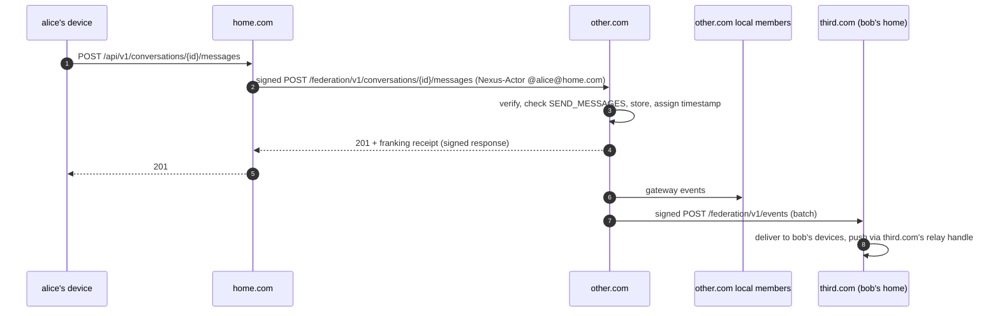

# Nexus Chat — Federation Protocol (v1)

Status: Phase 0 design. Decisions in [ADR 0005](adr/0005-federation.md) and
[ADR 0008](adr/0008-server-address-syntax.md) need review. **[REVIEW]**

## 1. Model: home-hosted

- Every **user** has a home instance, which holds their account, devices,
  key packages, backups and push handles.
- Every **server** has a home instance, which stores its structure,
  permissions, and encrypted messages, and acts as the MLS delivery service
  for its groups.
- A **remote user's** home instance authenticates the user and relays their
  traffic to the hosting instance. Devices only ever talk to their own home
  instance. The single exception is voice media, which goes straight to the
  hosting instance's LiveKit or TURN using a token issued through federation.
- No room replication. If the hosting instance is down, its servers are
  unavailable. Users' DMs and other servers keep working.

DMs between users on different instances are hosted by the instance of the
user who started the DM.

## 2. Addresses

| Kind | Syntax | Example |
|---|---|---|
| User | `@username@domain` | `@alice@example.com` |
| Server | `+name@domain` (recommended) or `name@domain` (spec) **[REVIEW]** | `+gaming@example.com` |

The server name is a per-instance unique slug (`[a-z0-9_.-]{2,32}`) that the
owner picks, separate from the display name. See
[ADR 0008](adr/0008-server-address-syntax.md) for why the `+` prefix is
recommended.

## 3. Discovery

`GET https://example.com/.well-known/nexus-chat`

```json
{
  "protocol": "nexus-chat-federation",
  "versions": ["1"],
  "api_base": "https://chat.example.com/federation/v1",
  "client_base": "https://chat.example.com",
  "keys": [
    { "keyid": "2026-11-ed25519-1", "alg": "ed25519",
      "public_key": "base64url…", "not_after": "2027-11-01T00:00:00Z" }
  ],
  "voice": { "livekit_url": "wss://chat.example.com/livekit" }
}
```

- `example.com` may delegate to another host (`api_base` on a different
  host), so `@alice@example.com` works while the instance runs at
  `chat.example.com`. The same document is also served at the instance's own
  host.
- Cached for its `Cache-Control` lifetime, at most 24 h. Keys are re-fetched
  immediately if an unknown `keyid` arrives.
- Fetched only over HTTPS with a valid public certificate. No HTTP
  fallback.

## 4. Server-to-server authentication

**HTTP Message Signatures (RFC 9421)** with Ed25519 (`alg="ed25519"`), via
`github.com/yaronf/httpsign` (Apache-2.0) ([ADR 0005](adr/0005-federation.md)).

Every federation request signs:
`("@method" "@target-uri" "content-digest" "content-type" "nexus-origin" "nexus-request-id")`
with parameters `created`, `expires` (max 5 min), `keyid`, `nonce`.

- `Content-Digest` (RFC 9530) uses `sha-256`.
- `Nexus-Origin: example.com` names the sending instance; the verifier
  looks up its keys via discovery.
- Responses are signed too, so a hosting instance cannot be impersonated by
  something on the path (beyond TLS).
- Replay protection: `nonce` + `created` are remembered for 10 minutes.
- Key rotation: a new key appears in discovery at least 24 h before it is
  used; old keys stay published until `not_after`.

The allow/deny policy is checked **before** signature verification, so a
denied instance costs no crypto work.

## 5. Acting on behalf of a user

Requests that act for a user carry `Nexus-Actor: @alice@home.com`. The
hosting instance trusts the home instance to vouch for its own users only:
`Nexus-Actor`'s domain must equal `Nexus-Origin`.

## 6. Endpoints (v1)

All under `api_base`, JSON bodies, idempotent by `Nexus-Request-Id`.

| Method & path | Direction | Purpose |
|---|---|---|
| `GET /users/{username}` | any → home | Public profile, UMK public key |
| `GET /users/{username}/devices` | any → home | Device list with certificates |
| `POST /users/{username}/key-packages:claim` | hosting → home | Claim one key package per device |
| `GET /servers/{name}` | any → hosting | Public server info (if discoverable) |
| `POST /servers/{name}/join` | home → hosting | Join via invite code or public join |
| `POST /servers/{name}/leave` | home → hosting | Leave |
| `POST /conversations/{id}/messages` | home → hosting | Submit MLS message + archive copy for a remote user |
| `POST /conversations/{id}/commits` | home → hosting | Submit commit/external commit + GroupInfo |
| `GET /conversations/{id}/group-info` | home → hosting | For external joins |
| `GET /conversations/{id}/archive?before=…` | home → hosting | Fetch archive copies (history) |
| `POST /events` | hosting → home | Batched events for the home's users (messages, membership, moderation, typing, presence) |
| `POST /voice/token` | home → hosting | LiveKit token or TURN credentials for a remote member |
| `POST /attachments/{id}:download-url` | home → hosting | Short-lived signed URL for ciphertext download |
| `POST /users/{username}/deleted` | home → all known peers | Account deletion: drop data |
| `POST /reports` | home → hosting | User report about content in a hosted server |

Permissions are always enforced by the hosting instance. The home instance
also enforces its own policy (for example, a suspended user is blocked
locally).

## 7. Message flow



## 8. Delivery guarantees and failure modes

| Failure | Behaviour |
|---|---|
| Hosting instance unreachable | Home instance queues the user's request (durable, in Postgres) and retries with exponential backoff (1 s → 1 h cap) for 72 h, then marks it failed and tells the device. The UI shows the message as "pending" |
| Home instance unreachable (for `/events`) | Hosting instance queues per destination, same backoff, 72 h. Older events are dropped and the home instance resyncs with `GET /conversations/{id}/events?after=` once it is back |
| Out-of-order events | Each event carries a per-(hosting, conversation) sequence number; gaps trigger a resync fetch |
| Epoch conflict | `409 epoch_conflict` passed back to the device, which re-syncs and retries |
| Signature invalid / unknown key | `401`; the receiver re-fetches discovery once, then rejects |
| Instance denied by policy | `403 federation_denied`; the sender stops retrying |
| Domain change (§3.4 of the spec) | The instance publishes a signed `moved_to` in its old discovery document for 90 days. Peers update stored addresses after confirming the new domain's discovery lists the old key |
| Clock skew | `created` must be within ±5 min; responses include `Date` so admins can see skew in logs |

## 9. Abuse controls

- Policy: off (default) / allowlist / open, plus a denylist.
- Per-peer rate limits on all endpoints, and a per-peer cap on queued
  outbound events.
- A hosting instance can ban a remote user or an entire remote instance
  from a server.

## 10. Versioning

Discovery lists supported versions. Paths are versioned (`/federation/v1`).
Unknown JSON fields are ignored; removing fields requires a new version.

## 11. Testing

The federation suite runs two (later three) instances in Docker Compose with a
test CA. Scenario: a remote user joins `+server@instanceA`, chats, reacts,
joins voice, and gets banned. Also covered: signature failures, replay,
denylist, and queue/retry when a peer is stopped and restarted.
