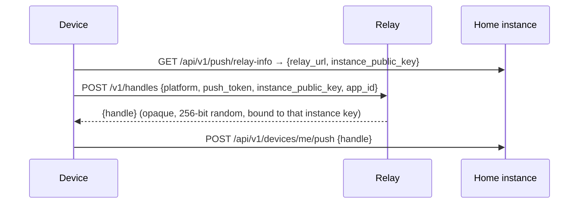

# Nexus Chat — Push Notifications

Status: Phase 0 design. Protocol, payload format, rate limits and hosting are
open for review ([ADR 0006](adr/0006-push-relay.md)). **[REVIEW]**

Principle: **no server-side component ever sees plaintext.** The instance has
none to give.

## 1. Delivery paths

| Platform | Default (store apps) | Fully self-hosted option |
|---|---|---|
| iOS | Official relay → APNs | Not possible with the store app (see §6) |
| Android | Official relay → FCM | UnifiedPush distributor (for example ntfy) |
| Web | Web Push (VAPID, per instance) | Same: no relay needed |
| Desktop (Electron) | The app's own WebSocket while it runs (including minimized to the tray), shown as native OS notifications. macOS (MAS build) can also use APNs through the official relay | Same WebSocket approach; needs no relay |

**Spec deviation [REVIEW]:** spec §4.10 lists Web Push for desktop, but
Electron does not implement the browser Push API, so Web Push can't wake a
closed Electron app. The design above notifies while the app runs, which
covers the usual tray-resident desktop use. Notifying while the app is fully
quit would need APNs (macOS) or WNS (Windows) through the relay, which can be
added after beta if wanted.

## 2. Official relay protocol (v1)

### 2.1 Instance registration (automatic, first boot)

1. The instance generates an Ed25519 key pair (`DATA_DIR/secrets/push-relay.key`).
2. When push mode "official relay" is enabled and `DOMAIN` is set, the
   instance calls `POST /v1/instances` with
   `{domain, public_key, proof}`, where `proof` is the instance's signature over
   `"nexus-chat-relay-register" || domain || public_key || timestamp`.
3. The relay checks that `https://{domain}/.well-known/nexus-chat` lists the
   same push key (`push_key` field), so a key cannot be registered for a
   domain it does not control. It then stores `{instance_id, domain, public_key}`.

### 2.2 Device registration (handles)



- The instance never sees the raw push token.
- `app_id` is the bundle ID or package name; the relay serves only the
  official apps (and their beta tracks).
- Devices re-register when the OS rotates the token (`PUT /v1/handles/{handle}`,
  authenticated by a per-handle secret returned at creation).

### 2.3 Sending

`POST /v1/push`, signed with RFC 9421 (Ed25519 instance key, same profile as
federation) and a batch body:

```json
{
  "pushes": [
    { "handle": "h_…", "priority": "high", "collapse_id": "c_…",
      "ttl_seconds": 3600, "payload": "base64url…" }
  ]
}
```

The relay accepts a push only if the handle exists, is bound to the
requesting instance's key, and that key is neither blocked nor rate limited.
Otherwise it returns a per-item error, so one bad handle doesn't fail the
batch:

| Error | Meaning |
|---|---|
| `handle_unknown` | Never existed or deleted. The instance drops it |
| `handle_wrong_instance` | Bound to another instance. Same response timing as `handle_unknown`, so it cannot be used to probe which instance a handle belongs to |
| `rate_limited` | With `retry_after` |
| `payload_too_large` | Over the limit in §2.4 |
| `instance_blocked` | Shown in the Admin panel with the operator's reason |

### 2.4 Payload format

The payload is opaque bytes produced by the instance:

```
payload = version(1 byte = 0x01) || type(1 byte) || body
type 0x01 "message": body = 16-byte message ID || the message's archive copy (history-key AEAD)
type 0x02 "fetch":   body = 16-byte conversation ID || 16-byte message ID
type 0x03 "sync":    body = empty (badge or read-state change)
```

- The size limit is **3,072 bytes** of payload before base64. Base64 makes it
  about 4,096 bytes, the APNs and FCM data limit, with room left for the
  envelope keys. Anything larger is sent as `fetch`.
- The relay maps it to an APNs `mutable-content` alert (so the Notification
  Service Extension runs) with a generic placeholder ("New message") that is
  replaced on device, or to an FCM data-only message.
- The push carries the **archive copy**, not the MLS live copy. Decrypting
  an MLS message advances ratchet state, which must not happen in a separate
  extension process racing the main app. The archive copy needs only the
  read-only history key. On iOS the extension reads history keys from an App
  Group keychain. If decryption fails, it shows "New message" with no content.
- A `fetch` push makes the device call its instance with its normal
  session credentials, within the roughly 30-second extension budget.

### 2.5 Rate limits

| Scope | Default | Notes |
|---|---|---|
| Per device handle | 30 per minute, 600 per hour (burst 10) | Above APNs and FCM recommended limits for a single conversation burst; collapse IDs merge bursts |
| Per instance | `max(20, active_handles / 50)` requests/s, burst ×5, capped at 2,000/s | Scales automatically with the instance's size; no admin steps |
| Registration | 10 new handles per device IP per hour; 100 instance registrations per IP per day | Prevents mass handle creation |
| Payload | 3,072 bytes | §2.4 |

Limits are applied with token buckets in memory. A 429 tells the instance to
queue and coalesce (for example, one `sync` push instead of 30 message pushes).

### 2.6 Cleanup

- The instance calls `DELETE /v1/handles/{handle}` (signed) on logout,
  device removal, or account deletion. The device also deletes it directly
  when leaving an instance.
- If APNs returns `410 Unregistered` / `BadDeviceToken`, or FCM returns
  `UNREGISTERED`, the relay deletes the handle immediately.
- Handles unused for 180 days are deleted.

### 2.7 Federation

A remote user's push always comes from their **home** instance, which is the
only instance holding their handle. Example: `@alice@home.com` is in
`+gaming@other.com`. A new message in `gaming` is passed by `other.com` to
`home.com` (`POST /federation/v1/events`), and `home.com` pushes with its
handle. If `other.com` used that handle, the relay would reject it with
`handle_wrong_instance`, because `other.com`'s signing key does not match.

Required relay tests: wrong-instance signature, forged handle, deleted handle,
blocked instance, rate limit, and the federation example above.

## 3. What the relay stores

| Data | Storage | Retention |
|---|---|---|
| Instance records `{domain, public_key, status}` | Postgres | Until the operator deletes or blocks the instance |
| Handles `{handle, instance_key, platform, app_id, push_token}` | Postgres, with `push_token` encrypted (AES-256-GCM, key from the relay's KMS or secret file) | Until cleanup (§2.6) |
| Payloads | **RAM only**: never logged or written to disk, and the host runs without swap | Dropped after APNs/FCM accepts it or the TTL passes |
| Logs | Aggregated counters only. No tokens, handles, payloads, or IPs beyond rate-limit memory | 30 days |

Handles and tokens must persist across restarts; storing them is not storing
content.

## 4. Official relay hosting requirements

- A single small VM or container host (2 vCPU, 2 GB RAM is enough for beta
  scale) plus managed Postgres, in two regions for availability later.
- TLS via the host's load balancer. APNs auth key (`.p8`) and FCM service
  account kept in the host's secret manager.
- Swap disabled, core dumps disabled, logging restricted to counters.
- Health checks and alerting on APNs/FCM error rates.
- Public documentation of what it logs, matching §3.

## 5. Per-user settings

Per server, channel and thread: all messages / mentions only / nothing;
mute for a duration; global do-not-disturb; "show message preview" toggle. The
instance applies these before sending, since it knows mention hints (see the
threat model), except "show preview", which the device applies after
decrypting.

## 6. Self-hosted push

- **Web:** Web Push with per-instance VAPID keys generated at
  first boot. The payload is the same opaque format, additionally encrypted
  per RFC 8291 by the Web Push library.
- **Android:** UnifiedPush. The store app shows a "Use UnifiedPush" option
  when a distributor app (for example ntfy) is installed. The instance posts the
  same opaque payload to the distributor endpoint, encrypted per RFC 8291
  (UnifiedPush's WebPush mode).
- **iOS:** Apple accepts pushes for an app only when they are signed with that
  app publisher's APNs key, so a self-hosting admin cannot push to the store
  app without the official relay. The only fully self-hosted option is to
  build and sign your own copy of the iOS app with your own Apple Developer
  account and APNs key, and run `apps/push-relay` yourself. Without push, the
  iOS app still receives messages whenever it is open.
