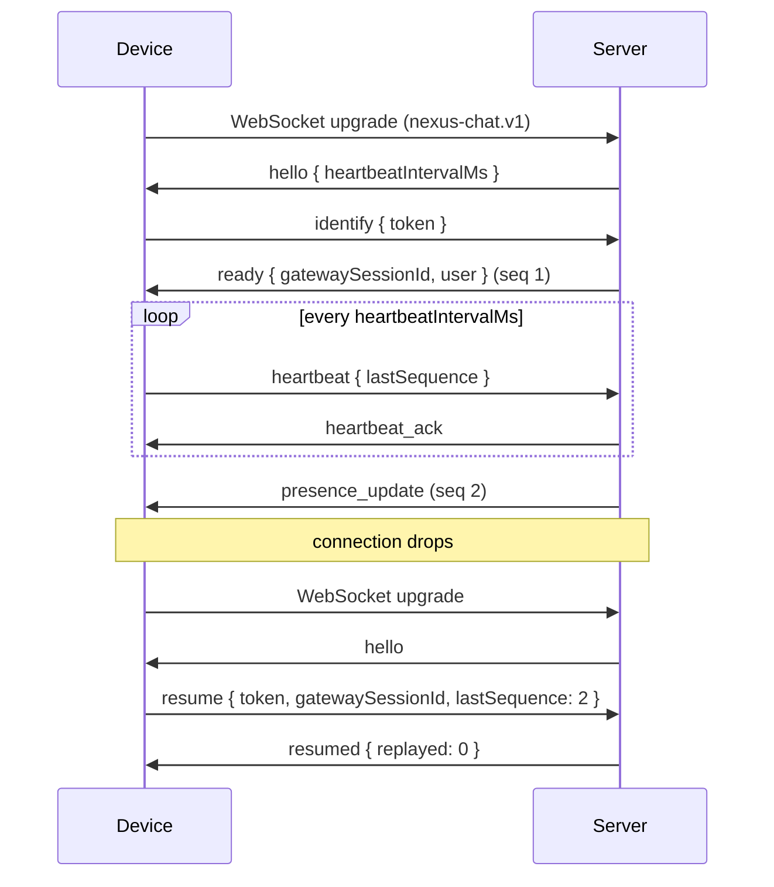

# Real-time protocol (gateway)

Every device keeps one WebSocket to its home instance for events that must
arrive at once: presence today, and messages, typing and membership changes
in later milestones. REST stays the way to change things; the gateway only
tells devices that something changed.

This document is the contract for version 1. The server implementation is
in `apps/server/internal/realtime`.

## 1. Connecting

```
GET /api/v1/gateway
Upgrade: websocket
Sec-WebSocket-Protocol: nexus-chat.v1
```

- The subprotocol `nexus-chat.v1` is required; a later incompatible
  protocol gets a new name.
- The session token is **not** put in the URL (URLs end up in logs). It is
  sent in the first frame, `identify` or `resume`.
- Browsers may connect from any origin. That is safe because the gateway
  never uses cookies: a page on another site has no token to send.
- Over plain HTTP the connection is `ws://`; behind HTTPS it is `wss://`.

## 2. Frames

Every frame is one UTF-8 JSON text message:

```json
{ "type": "presence_update", "seq": 42, "data": { "...": "..." } }
```

| Field  | Who sets it   | Meaning                                                        |
| ------ | ------------- | -------------------------------------------------------------- |
| `type` | both          | What the frame is (tables below)                               |
| `data` | both          | The frame's content; an empty object when there is none        |
| `seq`  | server        | Only on **events**: 1, 2, 3… per gateway session, never reused |
| `id`   | client (opt.) | Echoed in an `error` caused by this frame, to match them up    |

Unknown fields are ignored, so later versions can add them. An unknown
`type` from the client is answered with an `error` frame, not a disconnect.

### Limits

- A client frame may be at most **16 KiB**.
- A client may send at most **30 frames in 10 seconds** (heartbeats
  included). Beyond that the server closes the connection with code 4008.

## 3. Lifecycle



1. The server sends `hello` as soon as the socket opens.
2. The client sends `identify` (a fresh start) or `resume` within
   **10 seconds**, or the server closes with 4003.
3. The client sends `heartbeat` every `heartbeatIntervalMs` (30 seconds
   today; always read it from `hello`). If the server hears nothing for 1.5
   intervals it closes with 4009. Each heartbeat also re-checks the session
   token, so a session revoked elsewhere is disconnected within one
   interval, and an open gateway keeps the session's sliding expiry alive.
4. On disconnect, the client reconnects with exponential backoff (1 s, 2 s,
   4 s … capped at 60 s, plus random jitter) and tries `resume` first.

### Resuming

The server keeps a disconnected gateway session for **2 minutes**, with its
last **500 events**. `resume` with that session's ID and the `seq` of the
last event the client processed replays every later event, in order, with
their original `seq`, followed by `resumed`.

If the session is gone, belongs to another user, or the client is too far
behind, the server answers `invalid_session`. The client then sends
`identify` on the same connection and reloads its state over REST, because
events were lost. Events are never the only copy of anything durable:
messages and membership live in the database, so a fresh start loses
nothing that matters.

## 4. Client → server frames

| `type`      | `data`                                            | Notes                                                                            |
| ----------- | ------------------------------------------------- | -------------------------------------------------------------------------------- |
| `identify`  | `{ "token": "nxs_…" }`                            | Starts a new gateway session                                                     |
| `resume`    | `{ "token", "gatewaySessionId", "lastSequence" }` | Continues a dropped session (§3)                                                 |
| `heartbeat` | `{ "lastSequence": 41 }`                          | `lastSequence` is informational; 0 before any event                              |
| `activity`  | `{ "idle": true }`                                | The device's user has been inactive for 10 minutes (`true`) or is back (`false`) |

## 5. Server → client frames

Frames without `seq` are about the connection itself and are never
replayed. Frames with `seq` are events.

| `type`            | `seq` | `data`                                                              |
| ----------------- | ----- | ------------------------------------------------------------------- |
| `hello`           | no    | `{ "heartbeatIntervalMs": 30000, "protocolVersion": 1 }`            |
| `ready`           | yes   | `{ "gatewaySessionId", "user": CurrentUser, "presence": Presence }` |
| `resumed`         | no    | `{ "replayed": 3 }`                                                 |
| `invalid_session` | no    | `{}`                                                                |
| `heartbeat_ack`   | no    | `{}`                                                                |
| `error`           | no    | `{ "code": "unknown_type", "message": "…" }` (+ `id`)               |
| `presence_update` | yes   | `Presence` of a user this device follows                            |
| `user_update`     | yes   | `{ "user": CurrentUser }`, after the account changes                |

`CurrentUser` is the object from `GET /api/v1/users/me`. `Presence` is:

```json
{
  "userId": "0195…",
  "status": "online",
  "customStatus": { "text": "At the dentist", "expiresAt": "2026-11-08T15:00:00Z" }
}
```

`status` is `online`, `idle`, `dnd` or `offline`. A user who chose
`invisible` appears `offline` to everyone except their own devices, which
see `invisible`. `customStatus` is missing when none is set or it expired.

**Who gets `presence_update`:** in this version, the user's own devices.
Friends and fellow server members are added when those features exist
(milestones M4 and M5); the frame does not change.

## 6. Presence rules

- A user with no open gateway connection is `offline`.
- With at least one connection: their chosen status (`online`, `dnd`,
  `invisible`), except that `online` becomes `idle` when **every** connected
  device reports `activity { idle: true }`. A chosen `idle` stays `idle`.
- Presence changes are published when the effective status, or the custom
  status, changes. A custom status that expires is removed by the server
  within one minute, and a `presence_update` is sent.

## 7. Close codes

| Code | Meaning                                  | Client should                  |
| ---- | ---------------------------------------- | ------------------------------ |
| 1000 | Normal close (server shutting down)      | Reconnect and `resume`         |
| 4000 | Malformed frame (not JSON, too large)    | Fix the client; reconnect      |
| 4003 | No `identify` or `resume` in time        | Reconnect                      |
| 4004 | The token is invalid, expired or revoked | Log in again; do not reconnect |
| 4005 | `identify` or `resume` sent twice        | Fix the client; reconnect      |
| 4008 | Too many frames                          | Reconnect after backoff        |
| 4009 | No heartbeat in time                     | Reconnect and `resume`         |

## 8. Versioning

New event types and new fields may appear in version 1 at any time;
clients ignore what they do not know. Removing or changing the meaning of
a field needs `nexus-chat.v2`, which the server would offer alongside v1.
